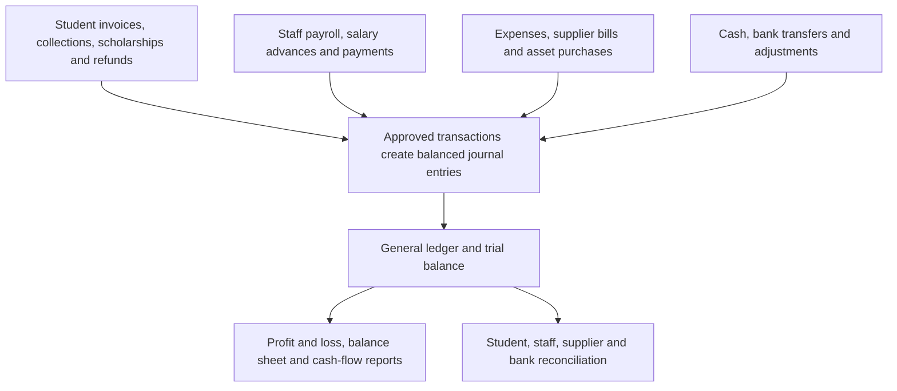

# Accounting: current status and one-developer work plan

**For the project owner and the developer assigned to accounting.** Reviewed 23 October 2026. This is the single document to use for this workstream. It describes inspected source code, not a tested live accounting system. All proposed models, APIs and tasks below are future work unless explicitly marked existing.

## 1. Where your accounting system stands today

**You have accounting screen designs and some useful financial fields. You do not yet have a working accounting engine.**

For example, a staff member has a basic salary, but the system does not have a permanent record saying: “October salary was calculated, approved, an advance was recovered, this amount was paid, and these entries went into the ledger.” Similarly, a student can have a fee record marked paid, but that is not a receipt, a bank transaction or a general-ledger entry.

The developer should reuse the useful screens and existing student/staff information, then build the accounting foundation underneath them. **Do not start by making the profit-and-loss page look finished. Build the transactions that make its numbers trustworthy.**

### What the backend already has

Most existing models below are in [backend/core/models.py](../backend/core/models.py).

| Existing model | What is already stored | What it does not provide |
|---|---|---|
| `FeeType`, `FeeSettings` | Fee names/default amounts and fee-related settings including late-fee configuration | Effective-dated fee plans, calculated invoices or financial postings |
| `AdmissionFee` | Admission charge by school, class and optional section | General recurring fee structures or a receipt |
| `StudentFee` | Student, admission fee, amount, due date, and `pending` / `paid` / `waived` status | Payment amount/history, partial-payment allocations, invoice lines, receipt numbers, refunds or ledger entries |
| `Scholarship`, `ScholarshipAssignment` | Award definitions, amount/percentage/full waiver and student awards | An approved adjustment applied once to a specific bill and posted to accounts |
| `BusFee`, `BusAssignment` | Route/session fee and optional student's custom transport charge | Automatically billed transport charges and collection reconciliation |
| `Staff` | `base_salary`, `pay_frequency`, `tax_status`, allowances/deductions JSON, bank details, benefit identifiers | Salary history by effective date, monthly payroll, payslips, approvals and actual payment records |
| `Teacher` in [domain/teacher.py](../backend/core/domain/teacher.py) | One-to-one Staff extension; tax percentage, employee/employer PF percentages, other deductions, tax/bank identifiers | A payroll calculation engine or statutory payroll compliance |
| `StaffLeave` | Staff leave dates, number of days, type and reason | A complete approved payroll-input workflow; the model has no explicit approval-status field |
| `Attendance` | **Student attendance** | Staff attendance. Do not use this model to calculate staff salary deductions |
| `School`, `Student`, `Parent`, `StudentParent`, `User` | School ownership, student identities, family relationships and accountant login role | Accounting authorization and transaction controls |

Admission processing already creates a pending StudentFee when an applicable admission charge is found. Admission-fee and student-fee serializers/views exist in [admission_serial.py](../backend/core/serial/admission_serial.py) and [admissions.py](../backend/core/view/admin/admissions.py). School fee settings, scholarships, transport and staff also have backend code. These are reusable inputs—not a completed accountant backend.

**Not found in the current models/routes:** chart of accounts, financial periods, journal entries/lines, full invoices and receipts, payment allocation, supplier bills/payments, payroll runs/payslips, salary advances/recovery, bank reconciliation, fixed-asset depreciation, or ledger-backed financial reports.

Important integration issue: existing staff APIs require school-admin permission. An accountant cannot simply be pointed at every admin endpoint. Add narrowly scoped finance access without exposing unrelated HR data or giving accountants unrestricted admin permissions.

### What the frontend already has

Sources below are under [school/src/pages/accountant](../school/src/pages/accountant). No direct API calls were found in these accountant pages or the accountant dashboard; inspected primary operations use local/sample state or simulated actions.

| Existing screen | Already designed | Still needed |
|---|---|---|
| `Fees.tsx` | Fee list, filters and collection-related UI | Real balances, receipts, allocations and payment/reversal actions |
| `FeeStructures.tsx`, `fee-management/FeeStructureSetup.tsx` | Fee structure forms | One consistent persisted structure model; consolidate overlapping screens |
| `fee-management/FeePackagePlans.tsx` | Packages of fee items | Versioned packages, applicability and calculation rules |
| `fee-management/AssignFeesToStudents.tsx` | Student-to-fee/package assignment | Persistent assignments, effective dates and duplicate prevention |
| `billing/GenerateMonthlyBills.tsx` | Sample students/bills and bill generation/print logic | Server billing, reliable numbering and idempotency. Code references undefined `feePackages`; payment matching uses a broad invoice prefix and must be replaced |
| `billing/StudentBillingLedger.tsx` | Student ledger presentation | Real invoice/receipt/credit/refund history and running balance |
| `billing/DueFeeReport.tsx` | Due-fee report presentation | Actual outstanding balances and aging calculations |
| `Payroll.tsx` | Sample staff, salary components, local net-salary calculation, “Process Payroll” button | Real staff selection, payroll calculation/approval/payment/payslips; process button currently displays a mock alert |
| `Expenses.tsx` | Expense list/forms | Supplier/expense persistence, approvals, attachments and payment/posting |
| `Scholarships.tsx` | Sample award/concession interface | Integration with existing awards and invoice adjustment rules |
| `Reports.tsx` | Choices including income statement, balance sheet and payroll summary | Actual report calculations/export. Current output is a mock generated-report message |
| `Settings.tsx` | Financial-year/currency/tax/provider settings UI | Persistent finance settings. Chart-of-accounts management is a TODO; gateway saving is mocked |
| `dashboard/AccountantDashboard.tsx` | Dashboard layout and example figures | Metrics calculated from real financial records |

**New screens still needed:** chart of accounts, journals and general ledger, trial balance, cash/bank reconciliation, supplier balances, payroll-run detail/payslips, salary advances/recoveries, financial-period closing and fixed assets. Some can be tabs within existing pages.

## 2. What the finished accounting system should handle

Think of it as five connected parts:

| Area | Finished behavior |
|---|---|
| Student accounts | Admission/tuition/transport/other charges; recurring bills; scholarships/discounts; partial/full collection; receipts; advance collection; credit notes; refunds; student statements and overdue reminders |
| Expenses and suppliers | Direct expenses, unpaid supplier bills, supplier payments/advances, attachments, approvals, petty cash and outstanding supplier balances |
| Staff payroll | All staff including teachers; salary revisions; earnings/deductions; approved unpaid-leave/overtime inputs; payroll approval; partial/full salary payments; payslips; outstanding salaries |
| Salary advances | Request, approval, disbursement, installment schedule, payroll/direct recovery, outstanding balance and final settlement |
| Cash/bank | Separate cash/bank accounts, deposits/withdrawals/transfers, statement matching, reconciliation and cashbook |
| Accounting books | Chart of accounts; opening balances; controlled manual journals; automatic postings; general ledger; trial balance; period locking and reversals |
| Assets and liabilities | Fixed assets, depreciation, disposal; loans/interest and other liabilities through controlled schedules/journals; deposits and prepayments |
| Reports | Fee dues/collections, student statements, supplier balances, payroll register, staff advance balances, general ledger, trial balance, P&L, balance sheet and cash flow |

This defines the target school-accounting scope. Full procurement/stock management, automatic bank feeds, multi-currency consolidation, tax-return filing and payment-gateway connections are separate extensions—not implied by a working ledger. Start with one configured base currency per school and manual bank/cash recording; keep provider integration separate.

### Important meaning of the reports

**General ledger:** every posted debit/credit movement grouped by account, with a link to the original bill, payment, payroll or journal.

**Profit and loss:** earned income minus expenses for a period. It is not simply cash received minus cash paid. A salary advance is money recoverable from staff; paying it must not count as salary expense again when payroll is later recorded.

**Balance sheet:** assets, liabilities and equity/fund balances at a date. Unpaid student bills, bank balances, staff advances, unpaid salaries and supplier balances appear here as appropriate.

**Cash-flow report:** movements in cash/bank classified by operating, investing and financing activity. Cash transfers between the school's own accounts must not inflate total inflows/outflows.

Proposed design: accrual accounting with double-entry journals. Billing and earning are not always the same event: charges for future teaching periods need a deferred-revenue/release policy. Revenue recognition should follow delivery of the relevant service; see the [IFRS Foundation's IFRS 15 overview](https://www.ifrs.org/issued-standards/list-of-standards/ifrs-15-revenue-from-contracts-with-customers/). This is an architectural proposal, not a determination that IFRS is the school's required reporting framework.

## 3. How the main workflows should work

### A. Student fees

Set fee types/packages → assign with start/end dates → preview bills → approve/issue → collect payment → allocate to one or more bills → issue receipt → show balance and ledger entry.

- Freeze fee rates and descriptions on issued invoice lines. Changing next month's rates must not change last month's bill.
- Apply scholarship/transport eligibility for the billing period, not just the student's current settings.
- Track payment amount separately from allocations. A 6,000 payment against a 10,000 bill leaves 4,000 due.
- Unallocated advance collections are student credits/liabilities until applied; do not fabricate a paid invoice.
- Credit notes reduce approved charges. Refunds return cash. They are different operations and must not reduce the same balance twice.
- Retrying bill generation must return/recognize the existing billing result, not generate another invoice.

### B. Payroll for teachers and other staff

Select existing Staff → set effective-dated salary structure → select payroll period → load approved attendance/leave/adjustment inputs → calculate → review → approve/post → pay → provide payslip.

Payroll must reference **Staff**, not create a second employee database. Teachers already link to Staff. Existing Staff and Teacher deduction fields overlap; choose one authoritative salary-component structure and migrate defaults rather than summing both sets blindly.

Each payslip stores a historical snapshot: basic salary, allowances, approved adjustments, deductions, employer contributions, advance recovery, net pay and actual payment balance. A later salary change must not rewrite an approved payslip.

Define paid/unpaid leave, partial months, overtime, rounding, arrears, bonuses and final settlement rules before automating them. Until staff timekeeping exists, use explicitly approved payroll inputs; do not infer payroll attendance from student attendance or treat every StaffLeave record as approved unpaid leave.

### C. Salary advance

Request → approve amount and recovery terms → actually disburse → record installments → recover through payroll or direct repayment → settle.

Approval alone does not move cash. Disbursement creates a staff advance receivable. Recovery reduces that receivable. Keep the original amount, paid-out amount, recovery transactions and remaining balance; do not store only one editable “advance balance” number.

Allow partial disbursement/recovery, rejected/cancelled requests, rescheduling with audit history and staff departure/final settlement. Prevent recovery greater than the outstanding amount. If net salary is insufficient, flag the shortfall for an approved carry-forward instead of silently creating negative pay. Agree recovery caps with the school's payroll adviser; do not hardcode legal limits from examples.

### D. Supplier expenses and assets

Record supplier bill/expense and attachments → approve → classify as expense, asset or prepayment → post → pay immediately or later → reconcile.

A computer purchase may be an asset, not an immediate expense. Loan principal repayment is not interest expense. Configure these account mappings so P&L does not treat every cash outflow as a cost.

## 4. Backend design the developer should add

Suggested implementation: a dedicated Django `accounting` app linked to existing `core.School`, `Student` and `Staff`. The names below are proposed groups, not existing models or a requirement to create every table in the first task.

| Group | Proposed records | Essential information |
|---|---|---|
| Setup | `FinancialYear`, `AccountingPeriod`, `Account`, `FinanceSettings` | School, dates/open-closed status, account code/name/type/parent, posting allowed, currency and document sequences |
| Accounting engine | `JournalEntry`, `JournalLine`, audit/approval records | Date, source document, status, reference, reason, account, debit/credit, student/staff/supplier reference; creator/approver/poster/reversal links |
| Fees | `FeeStructure`, `FeeStructureLine`, `FeePackage`, `StudentFeeAssignment` | Effective dates, billing frequency/service period, fee components/rates and account mapping |
| Student billing | `Invoice`, `InvoiceLine`, `CreditNote` and lines | Student, number, period, frozen amounts, due date, approved adjustments and journal/source links |
| Collections | `Receipt`, `PaymentAllocation`, `Refund` | Cash/bank/payment reference, amount, invoice allocations, unapplied credit, refund/credit link and posting link |
| Suppliers | `Supplier`, `SupplierBill` and lines, `SupplierPayment` and allocations | Liability/expense/asset classification, due date, amounts, approvals, supporting files and settlement |
| Payroll | `SalaryStructure` and components, `PayrollInput`, `PayrollRun`, `Payslip` and lines, `SalaryPayment` and allocations | Effective dates, approved inputs, immutable calculated snapshot, employee/employer items and unpaid amount |
| Staff advances | `SalaryAdvance`, `AdvanceDisbursement`, `RecoverySchedule`, `AdvanceRecovery` | Staff, approval, disbursement dates/amounts, installment plan, payslip/payment links and outstanding amount |
| Cash/bank | `CashBankAccount`, `BankStatementLine`, reconciliation session/matches | Ledger account link, statement source, transactions, matching and unresolved differences |
| Assets/deferrals | `FixedAsset`, depreciation schedule; deferred-income/prepayment schedules | Cost/account, useful-life policy, period releases, disposal and journal links |

**Do not add an independently editable “general ledger balance” table.** The ledger/report queries derive from posted journal lines; any cached balance must be rebuildable and reconciled. Likewise, student/staff/supplier subledgers must reconcile to their general-ledger control accounts.

Use a single posting service for all modules. Posting must atomically validate permissions, financial period, balanced amounts and source uniqueness, then record the business transaction's posted state and journal. Duplicate requests/concurrent cashiers must not double-post or over-allocate a payment.

Required controls from the first transaction:

- Every record belongs to a school; validate all related IDs against that school on the server.
- Use decimal money and server-side calculations. Never trust totals calculated only by React.
- Total debits equal total credits; each nonzero line has one side only; posted accounts must be active posting accounts.
- Enforce document-number uniqueness per school/year/type and unique source-posting/billing keys at database level.
- Posted documents cannot be deleted or silently edited. Corrections use linked reversal/adjustment documents in an open period.
- Do not cascade-delete posted finance history when a student/staff record is removed; retain required snapshots and protected references.
- Separate accountant preparation from designated approval of payroll, refunds, advances, manual journals and reopening periods. Define approval thresholds and audit every privileged action.
- Restrict salary/bank details to authorized users. Students/parents see only their permitted statements; staff see only their permitted payslips/advances.
- Initial APIs can use `/api/accounting/` with explicit actions such as `preview`, `approve`, `post`, `reverse`, `allocate` and `reconcile`; these are proposed endpoints, not registered routes today.

## 5. Simple accounting example you can use to check the developer

Illustration only: one school, one currency, no tax on fees, a service already earned, no opening balance. Amounts are arbitrary. Actual statutory deductions and account policy must be configured separately.

| Action | Debit | Credit |
|---|---|---|
| Issue 10,000 earned tuition bill | Student receivables 10,000 | Tuition income 10,000 |
| Collect 6,000 | Bank 6,000 | Student receivables 6,000 |
| Pay staff advance of 1,000 | Staff advance receivable 1,000 | Bank 1,000 |
| Approve salary of 4,000, with 500 withheld deduction | Salary expense 4,000 | Deduction payable 500; salary payable 3,500 |
| Recover 500 of the advance through this payroll | Salary payable 500 | Staff advance receivable 500 |
| Pay remaining salary of 3,000 | Salary payable 3,000 | Bank 3,000 |

Expected results after all six actions:

- Student still owes **4,000**.
- Staff advance still outstanding: **500**.
- Salary payable: **0**; deduction payable: **500**, until separately remitted.
- Bank: **2,000** (= 6,000 − 1,000 − 3,000).
- P&L: income **10,000**, salary expense **4,000**, surplus/profit **6,000**.
- Balance sheet: assets **6,500** (= bank 2,000 + student receivable 4,000 + advance 500); liabilities **500** plus current-period surplus **6,000**.

If the system reports the 1,000 advance as another salary expense, counts the 6,000 receipt as income a second time, or cannot reconcile these reports, the accounting implementation is incorrect for this example.

## 6. Assign work to ONE developer in this order

Give the developer **one numbered assignment at a time**. Each includes backend, UI integration and tests. Do not mark it done just because a page renders or Swagger lists an endpoint. All assignments below are currently open; effort/date estimates should follow the first working slice.

| Order | Assignment to give | What you should ask them to demonstrate before the next assignment |
|---|---|---|
| **1** | Set up isolated local accounting work; agree school/currency/year/accounting policies; design finance permissions and migration approach | Accountant login works locally; two test schools exist; existing finance inputs identified; no calls to the hardcoded remote API; proposed schema and account mappings reviewed |
| **2** | Build financial year/period, chart of accounts, journal engine, opening balances, basic GL and trial balance | A balanced journal posts once; unbalanced/cross-school/closed-period posting is rejected; reversal works; trial balance agrees. No fee UI needed yet |
| **3** | Persist fee structures/packages/assignments; reuse student, admission fee, scholarship and transport inputs | Configure fees for real test students; reload and retain them; effective dates work; accountant sees only approved data; agreed defaults do not double-charge admission |
| **4** | Build invoice preview/issue and automatic accounting postings | Generate a month's bills twice without duplication; verify rates/discounts and service period; issued invoice survives rate edits; student balance and GL agree |
| **5** | Build receipts, allocation, student credits, credit notes, refunds and student statements | Partial payment leaves correct due; one receipt can settle multiple bills; overpayment becomes credit; reversal/refund works once; print/export and GL reconcile |
| **6** | Build expenses, suppliers, bills, supplier advances and payments | Record paid and unpaid expenses, partial supplier payment and an asset purchase; supplier balance and GL reconcile; attachments/approvals persist |
| **7** | Build effective-dated salary structures and payroll preview/approval/payslips | Select existing Staff, including teachers; approved inputs calculate salary; snapshot survives a later raise; employee deductions and employer costs separated; posting happens once |
| **8** | Build salary advances, disbursements, recovery schedule and payroll recovery | Give 1,000, recover 500 and show 500 outstanding; approval alone does not change bank; two payroll retries cannot recover twice; insufficient-pay and final-settlement cases handled |
| **9** | Build salary payments, deduction remittances, staff statements and private payslip access | Partial/full salary payments settle payable; advances remain separate; deduction remittance reduces liability; one employee cannot read another's payslip |
| **10** | Finish cash/bank book, transfers, statement import/manual matching and reconciliation | Bank statement and book differences explained; duplicate statement import prevented; internal transfer has no P&L effect; fees/interest adjustments post correctly |
| **11** | Add fixed assets/depreciation and income/prepayment release schedules; finish financial reports | GL-backed P&L/balance sheet/cash flow with drilldown; depreciation/releases post once; student/supplier/staff totals reconcile to control accounts; run the six-action example above |
| **12** | Opening-data import, month/year close, audit/export, backup/restore and release acceptance | Legacy balances reconciled without inventing receipts; locked period cannot be edited; approved reopening audited; restored backup reproduces balances; one complete school month closes correctly |

**Developer's first instruction you can copy:**

> Work on Accounting Assignment 1 in `docs/ACCOUNTING_PLAN.md`. Inspect the existing Staff, Teacher, StudentFee, AdmissionFee, Scholarship and transport-fee models. Prepare an isolated local dataset, the accounting model proposal and school-scoped permissions. Demonstrate local accountant access and present the proposed journal/account mappings. Do not implement every accounting screen at once. After review, proceed to Assignment 2: the journal engine and basic ledger.

### Tests the developer must keep adding

Each assignment must include successful persistence/reload, wrong-role and other-school access, validation, repeated requests and rollback on failure. Money-moving tasks additionally need concurrent-request tests, exact decimal totals, reversals and reconciliation. Payroll needs duplicate runs, effective-date changes, zero/partial pay, recovery caps and historical-payslip tests.

Every demo should include: the source document, its journal entry, the relevant student/staff/supplier balance, and the resulting report. This lets you lead the work without reading every line of code.

## 7. Decisions you need to make with the school/accounts person

These decisions can be resolved as their assignments approach; they are not reasons to stop the initial local setup.

| Decision | Why the developer needs it |
|---|---|
| Country, base currency, financial-year dates and reporting basis | Current mock screens mix example currency/tax conventions. They are not approved requirements |
| Fee frequencies, due dates, partial periods, late charges and scholarship order | Determines correct invoice amounts and when they are earned |
| Salary structure, payroll period, paid/unpaid leave, overtime and statutory rules | Existing percentage fields do not establish correct current payroll calculations |
| Salary-advance eligibility, approval, maximum recovery and departure policy | Determines recovery schedules and insufficient-pay handling |
| Approval roles/thresholds and who can reopen periods | Controls refunds, advances, payroll and adjustments |
| Go-live date and reliable opening balances | A `StudentFee.status='paid'` record alone does not prove when/how money was collected |

Have the responsible accountant approve the account mappings, tax/payroll rules and final reports before live use. The target reports include financial position, P&L and cash flows; the [IFRS Foundation's presentation overview](https://www.ifrs.org/issued-standards/list-of-standards/ias-1-presentation-of-financial-statements.html/) explains their distinct purposes, but the applicable local reporting framework still needs to be established.

**Migration rule:** choose a cutover date, reconcile old dues/cash/bank/payables/advances, and import approved opening balances with a legacy-reference trail. Do not replay historical invoices into income if that income is already included in opening balances. Keep detailed student/staff/supplier opening schedules equal to their control-account totals. Existing records do not contain enough evidence to reconstruct every historical receipt automatically.

**Completion target:** a real school month can be billed, collected, expensed, payrolled, reconciled and closed, with all supporting documents and reports agreeing. Only then is this a working accounting system rather than a set of accounting screens.

## 8. Review of your three PDF assignments

**Verdict: continue with the plan after the corrections below. Assign the revised Day 01 now; do not promise the complete system in 30 working days.** The core direction is sound: investigate first, build journals before billing, then connect transactions and reports. You do not need to restart the planning exercise.

Reviewed all 17 pages of the three supplied PDFs against checkout `efae2353`. This was a content/source review, not execution of their instructions, live API testing, or a visual print-layout review. The original PDFs have not been changed. This section is the correction sheet to send with them.

| PDF | Decision |
|---|---|
| `Day_01_School_Accounting_Developer_Assignment.pdf` — 4 pages | Good investigation assignment. Add local setup prerequisites, separate blocked checks from failed acceptance, and reduce paperwork. No new accounting implementation on Day 01 |
| `School_Accounting_30_Day_Step_by_Step_Developer_Handbook.pdf` — 9 pages | Good work breakdown, with several dependencies to move earlier. Treat its 30 days as 30 work packages whose duration depends on evidence |
| `School_Accounting_Existing_vs_Missing_Technical_Guide.pdf` — 4 pages | Broadly agrees with current code. Useful reference, not a complete field-level schema/API specification. Clarify enrollment migration and school keys before building |

### A. Day 01: changes before you assign it

| PDF location | Add or change | Why it matters in this repository |
|---|---|---|
| Page 1, safe setup | Before opening interactive screens, point Axios to the isolated local API and confirm requests in browser Network tools | `school/src/api.ts` hardcodes a remote HTTP base URL. A local React server does not guarantee local backend calls; existing image-related `VITE_BACKEND_URL` settings do not configure Axios |
| Page 1, test schools/users | Give each school an active, non-expired Subscription; create sessions/classes/sections and linked Staff/Teacher/Student/Parent records as needed | `core/views.py` rejects ordinary-user login without an active subscription. A user role alone does not create the related profile |
| Page 1, baseline | Record dependency/import/migration blockers before insisting every screen works | Requirements omit imported ReportLab. The earlier selected Python had no Django. Verify the developer's actual environment instead of assuming the committed virtualenv works |
| Pages 1 and 4, inspect every action | Complete runtime checks when startup works; otherwise record NOT VERIFIED + blocker + next step | Auth startup has a known `parsedUser` issue and the billing action references undefined `feePackages`. A crash is useful evidence; the developer must not fake successful persistence to finish Day 01 |
| Pages 2–3, model map | Record integer school PK versus school UUID for each relation, and inspect the existing promote action | Student.school uses **School.id (integer)**; User.school uses **School.school_id (UUID)**. Student stores current class/section/session; historical enrollment is a proposed addition |
| Page 3, permission tests | Run all wrong-school/wrong-role tests only with synthetic local records; record endpoint, actor, input and actual response | Admin-only denial may be expected. A denied accountant list does not prove admin queries or writable relations are tenant-safe. Test an authorized role against the wrong school's IDs as well |
| Pages 3–4, six deliverables | Submit one `DAY01_REVIEW.md` with six sections and a small evidence folder | The content is useful; six separate reports duplicate work for one developer and are harder for the owner to review |
| Page 4, sign-off | Distinguish “investigation accepted” from “environment/implementation gate passed” | A clearly documented baseline defect should not invalidate honest investigation, but unresolved startup/schema/permission blockers must not be ignored before finance implementation |

Baseline evidence already available in this repository: the earlier frontend build passed, TypeScript reported 366 diagnostics and lint reported 438 issues. These are dated baseline results, not newly rerun checks and not a demand to repair the whole project on Day 01. Attach current results and identify which failures block accounting.

**Corrected Day 01 instruction — copy this to the developer:**

> Audit accounting only. First record your branch/commit and establish an isolated local backend, database and frontend API target. Recreate the environment, verify dependencies/migration state, and use synthetic data. Create School A and B with active subscriptions, admin/accountant users and the related student/staff/session records needed for tests. Do not use production accounts or data.
>
> Inspect every accountant screen and main action; distinguish local state, real API persistence, broken behavior and unverified behavior. Trace the existing fee/salary models, routes and permissions. Verify school keys individually and inspect current admission/promotion behavior. Test a wrong-school ID using both an accountant and an otherwise authorized role, only locally.
>
> Submit ONE `DAY01_REVIEW.md` containing: setup and baseline checks; screen/action inventory; backend model/API map; three current-versus-proposed flows; ranked blockers/gaps; and demo notes plus the next task recommendation. Screenshots and redacted request/response evidence can go in an evidence folder. Store no tokens or passwords in the report.
>
> Do not build invoices, payroll, ledger or new finance screens. Small local configuration/dependency repairs needed for inspection are allowed and must be listed separately; record larger application repairs as prerequisite tasks. If startup blocks runtime checks, finish source inspection and mark those checks NOT VERIFIED with the exact blocker. Review those blockers with the owner before proceeding to accounting implementation.

**Accept the investigation when** you can see what exists, what is mocked, what was actually tested and what blocks the next step. **Proceed to finance implementation when** the isolated environment, relevant identity/schema mappings and required access paths are understood and working. Full cross-school security defects require fixes/tests before the affected APIs are used for real finance workflows.

### B. Corrections to the 30-step sequence

Keep the PDF numbering for tracking; move or split these dependencies rather than rewriting every assignment.

| Existing step and page | Correction |
|---|---|
| Day 01 title, page 1: “connect real data” | Rename to “inspect and prove current behavior.” The detailed Day 01 PDF correctly prohibits new feature integration |
| Days 02–05, pages 1–2 | Add the **minimal cash/bank account model and mapping to GL accounts** here. Collection and expense screens need a valid money account before Day 14/18. Day 20 can still add the full cashbook, transfers and petty-cash UI |
| Days 06–11, pages 3–4 | Design session-enrollment history **before** fee structure/assignment implementation. Reuse Student, AcademicSession, Class and Section. Define how the existing promote endpoint and current Student fields stay consistent with new history; do not build a disconnected second promotion system |
| Day 11, page 4: rollover demo with old dues | Split it: model/history design and a dry preview before billing; full old-invoice/receipt/credit carry-forward acceptance **after Days 12–17**. Those records do not yet exist at Day 11 |
| Day 12, page 5 versus Day 27, page 9 | Decide earned/deferred account mapping and service-period snapshots before invoice posting. If future-period fees are in the release, implement their minimum release logic with billing; do not leave it undefined until Day 27. Day 27 can expand asset/prepayment schedules |
| Day 18 versus Day 19, page 7 | Create supplier identity and minimum payable-document support before Day 18's “expense on credit” demo. Alternatively limit Day 18 to immediately paid expenses, then add credit bills with Day 19 |
| Day 24 versus Day 25, page 8 | Define advance-recovery integration in the payroll calculation contract before approval/posting. After implementing advances, rerun payroll acceptance with recovery. Recover from a draft/new run or explicit adjustment, not by silently changing a posted payslip |
| Day 29, page 9 | Keep final migration/close rehearsal here, but define opening-balance cutover and data-mapping rules during Days 02–05. Closed-period enforcement already belongs in the journal engine, not the final week |
| Day 30 and global demo rules, pages 1 and 9 | Add automated tests as each feature is built; Day 30 runs the accumulated suite. Setup/catalog tasks do not need fabricated journal entries just to meet the generic “every demo has a journal” rule |

Two acceptance statements also need precision:

- **Day 14 “cannot collect beyond balance”:** distinguish receipt recording from invoice allocation. Allocations cannot exceed the outstanding invoice or available receipt/credit amount. Once Day 15's advance-collection feature is implemented, an authorized overpayment may be recorded as separate unapplied credit; it must not be allocated twice.
- **Day 16 “no negative balance”:** require nonnegative remaining invoice due and nonnegative available credit/recovery amounts. A signed consolidated customer statement may legitimately show a credit balance. Do not reject valid overpayments/refunds merely because the presentation uses a negative signed balance.

The technical guide's page 3 adds family/sibling allocation. Keep that a separately accepted extension until the payer/child authorization and per-student allocation rules are implemented. An ordinary student's receipt must not silently settle another student's debt. Also add explicit acceptance for supplier advances and asset disposal if retaining them in the target scope; supplier partial payment and depreciation alone do not cover them.

### C. Code-specific clarifications for the technical guide

- **Promotion is not completely absent.** `StudentView.promote` in `core/view/admin/admissions.py` already invokes StudentSerializer to update the current student record. The missing piece is a designed, persistent session-enrollment history and finance-safe rollover integration. Confirm mutation/compatibility behavior before changing it.
- **Student school key correction:** current `Student.school` targets the integer PK; migration `0011_alter_student_school.py` agrees. My earlier general handover incorrectly described that relation as UUID and called the attendance integer filter a defect. Those notes have now been corrected. Do not use that old claim as a repair task.
- **No fresh testing claim:** the guides are accurate to say their starting point is source inspection. Runtime persistence, actual database migration state and production behavior still need Day 01 evidence.
- **Approval and finance policy remain specifications to settle.** Example Puja/coaching/readmission fees are configurable examples, not proof that your school requires them. Do not implement local tax percentages, salary recovery limits or compulsory charges from sample UI values.

### Owner's decision

**Assign corrected Day 01 now. Keep the technical guide as reference. Continue the handbook as reviewed work packages after moving the dependencies above.** One package may take multiple days, and setup repairs may need their own package. Re-estimate after the local baseline and the first journal/billing slice; the PDFs provide no evidence supporting a guaranteed 30-day completion date for one developer.
