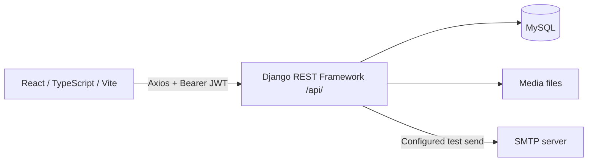

# Architecture and data guide

## Runtime shape



The repository contains a single frontend and a Django project with one main application, `core`. It is not six separate applications: `App.tsx` selects role-protected screens inside a shared layout.

## Code map

| Location | Responsibility |
|---|---|
| `school/src/App.tsx` | Frontend routes and role gates |
| `school/src/contexts/AuthContext.tsx` | Login, local token/user persistence, initialization, logout |
| `school/src/api.ts` | Axios base URL, Authorization header and token refresh |
| `school/src/components/layout/` | Sidebar, top bar, breadcrumbs, footer and shared layout |
| `school/src/components/common/` | Buttons, cards, modals, route guard, chat demonstration |
| `school/src/pages/` | Role-specific feature screens, plus embedded helpers |
| `backend/backend/settings.py` | Django apps, MySQL, JWT, CORS, media, security and logging |
| `backend/backend/urls.py` | `/admin/`, `/api/`, development media wiring |
| `backend/core/urls.py` | Explicit API paths and DRF router registrations |
| `backend/core/models.py` | Most entities and some model behavior |
| `backend/core/domain/teacher.py` | Teacher extension of Staff |
| `backend/core/domain/teacher_assignment.py` | Teacher-to-class/subject assignments and class teachers |
| `backend/core/view/admin/`, `view/superuser/` | Most administrative/platform views |
| `backend/core/serial/` | Serializers **and some views**; teacher/student API handlers are here |
| `backend/core/migrations/` | Fourteen numbered migrations through `0014` |
| `backend/core/dummy_models.py` | Five unmanaged legacy scheduling placeholders; not a working timetable model layer |
| `backend/core/tests.py` | Empty test scaffold |
| `school_db (1).sql` | Existing dump; schema/data provenance and safety need verification before use |
| `backend/env/`, `backend/staticfiles/`, `backend/debug.log` | Environment/generated/log artifacts; not application source or a portable setup procedure |

The frontend package uses React 18.3, React Router 6, Axios, Tailwind, React Hook Form, Recharts and browser PDF packages. Backend requirements pin Django 5.2.1, DRF 3.16, SimpleJWT 5.5 and multiple database drivers; the active engine is MySQL. `backend/package.json` only declares Axios and is not the backend runtime entrypoint.

## Roles and authorization

| Experience | Stored role | Expected data scope |
|---|---|---|
| Superadmin | `admin`, `is_superuser=True` | Platform schools and subscriptions |
| School admin | `admin` | Own school and its staff/students/configuration |
| Teacher | `teacher` | Own school and assigned classes/subjects |
| Student | `student` | Own student data and authorized class materials |
| Parent | `parent` | Children explicitly linked through StudentParent |
| Accountant | `accountant` | Authorized school financial records |

This is the intended scope for implementation/testing, not a statement that every endpoint already enforces it. Global DRF permission is `IsAuthenticated`. Some views add `IsSchoolAdmin`/`IsSuperuser`; others inherit only authentication. DRF `IsAdminUser` checks `is_staff`, which is not the same as the custom `role == 'admin'`.

Login uses email/password. Non-superusers require an active, non-expired Subscription. Access tokens last 60 minutes and refresh tokens one day in the checked-in settings. Tokens and user details are stored in localStorage. Logout clears local data; it is not demonstrated server-side token revocation. Current refresh route uses the standard SimpleJWT view, while one frontend fallback expects a `user` property the refresh response does not supply.

## Main relationships

```mermaid
erDiagram
  School ||--o{ User : contains
  School ||--o{ Subscription : has
  User ||--o| Staff : profile
  Staff ||--o| Teacher : extension
  User ||--o| Student : profile
  User ||--o| Parent : profile
  Student ||--o{ StudentParent : links
  Parent ||--o{ StudentParent : links
  Class ||--o{ Section : contains
  Class ||--o{ Student : enrolls
  Teacher ||--o{ TeacherAssignment : teaches
  Class ||--o{ TeacherAssignment : receives
  Subject ||--o{ TeacherAssignment : specifies
  Student ||--o{ Attendance : records
  Exam ||--o{ Score : contains
  Student ||--o{ Score : earns
```

The diagram is a selected conceptual map; use [backend-models.csv](inventory/backend-models.csv) for declared fields, foreign keys, `to_field`, delete behavior and through tables.

- **Identity:** User, School, Subscription; Staff, Teacher, Student, Parent and StudentParent.
- **Configuration:** locale, academic sessions/terms/holidays, classes/sections/subjects, grading, attendance, fees, notifications, campuses/buildings/rooms/resources, staff roles/departments/leave types.
- **Admissions:** student profiles, parents, StudentFee/AdmissionFee, documents and certificates.
- **Teaching:** TeacherAssignment and ClassTeacher represent teaching allocation. Attendance records use Student profiles.
- **Exams:** Exam, ExamClass, ExamSubject, Score; scholarships and ScholarshipAssignment.
- **Homework:** Assignment and AssignmentSubmission coexist with TeacherAssignmentToStudent. Current teacher/student homework APIs use TeacherAssignmentToStudent. Do not confuse homework with TeacherAssignment (teaching allocation) or `/assignments/` (scholarship awards).
- **Operations:** Route, Bus, BusFee, BusAssignment; Event/EventAssignment and Notice.
- **Finance gaps:** existing fee/salary fields are inputs. No complete persistent invoice/payment/expense/payroll workflow corresponding to the accountant screens was found.

School references are mixed: some fields target the integer primary key, others explicitly target `School.school_id` (UUID). User.school targets the UUID; Student.school explicitly targets School.id (integer), consistent with migration 0011. Code must not interchange the raw values. The attendance student-list filter using `school=school.id` matches the current Student model; it is not by itself a defect. Verify each relationship and the actual local migration state before changing filters.

## API conventions and contracts

All application endpoints are mounted under `/api/`. Routes generally use trailing slashes. Most calls are JSON; document/image/homework uploads use multipart FormData. Responses are not consistently enveloped: some are arrays, some objects, some custom messages. Inspect the exact serializer and view before defining frontend types.

The generated route CSV lists declared methods for explicit APIViews and mappings. DRF ModelViewSet registration normally exposes collection GET/POST and detail GET/PUT/PATCH/DELETE, plus decorated actions. It does not establish permission, successful execution, or payload validity. Token routes come from SimpleJWT; OPTIONS/HEAD/framework-generated formats are not enumerated.

## Workflow dependencies

1. Superadmin creates school, admin and active subscription.
2. Admin sets school information, session/terms, classes/sections/subjects and applicable fees.
3. Admin creates staff/teachers and assigns teaching/class responsibility.
4. Admin admits a student and links parent(s), class/section/session and documents/fees.
5. Teacher records attendance, creates homework and enters marks; student submits homework.
6. Student/parent read projections must be added for most data already stored by admin/teacher workflows.
7. Accounting requires an agreed financial model before fee collections, dashboards and reports can become authoritative.

The UI is already a useful requirements reference, but sample amounts/statuses do not establish approved business rules.
